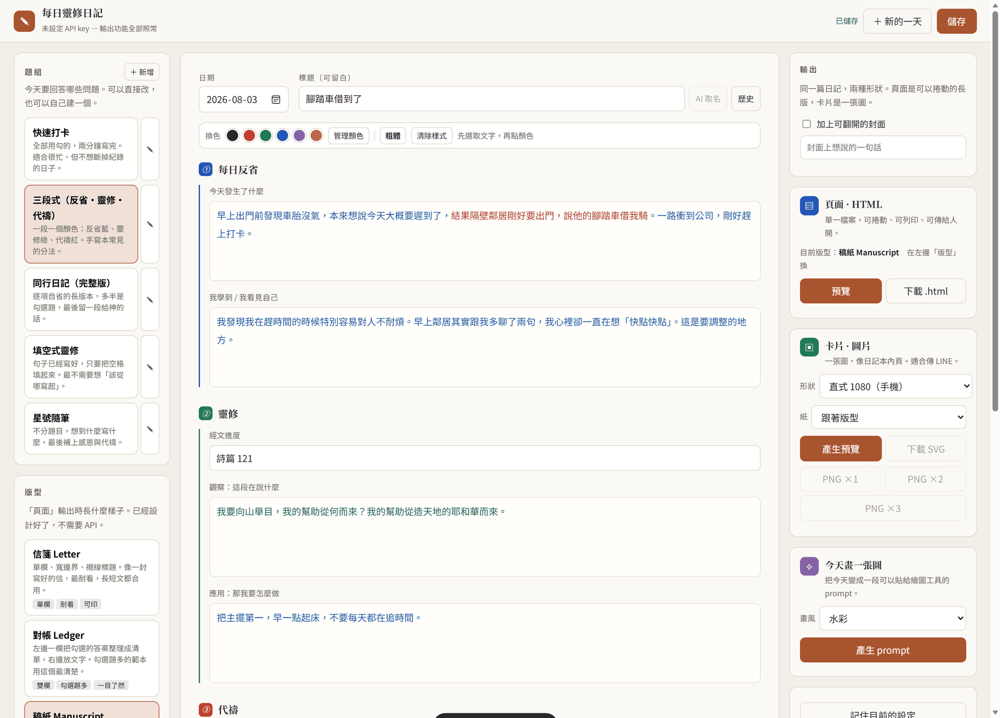
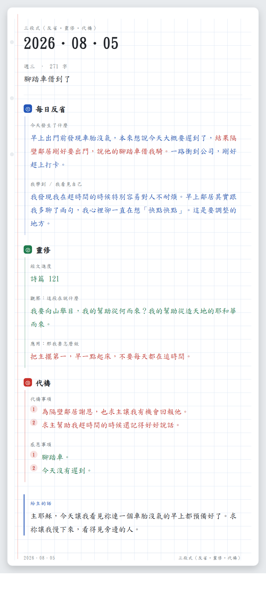
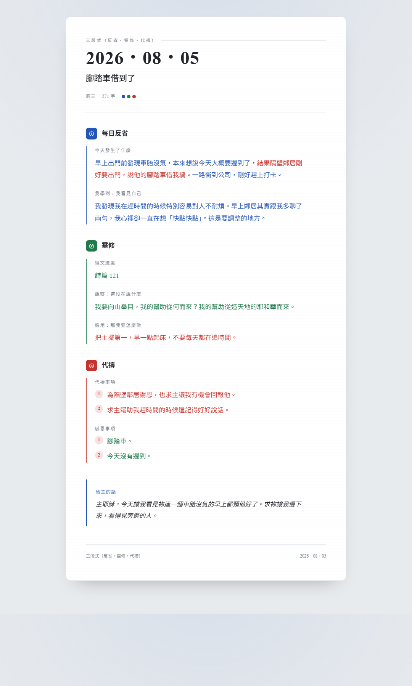
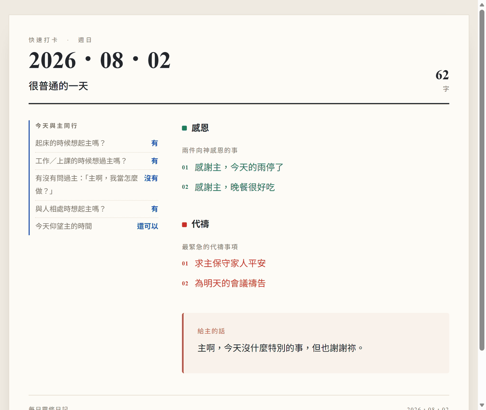
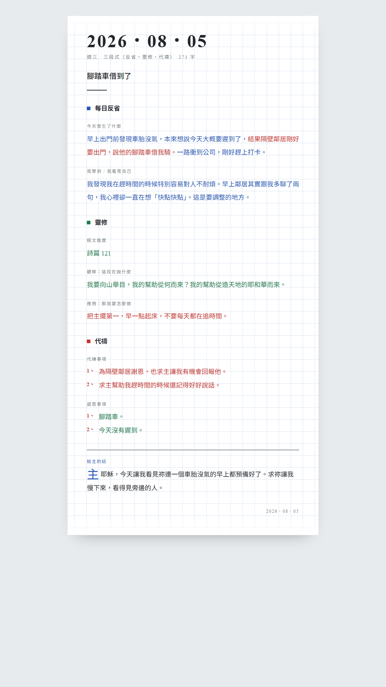
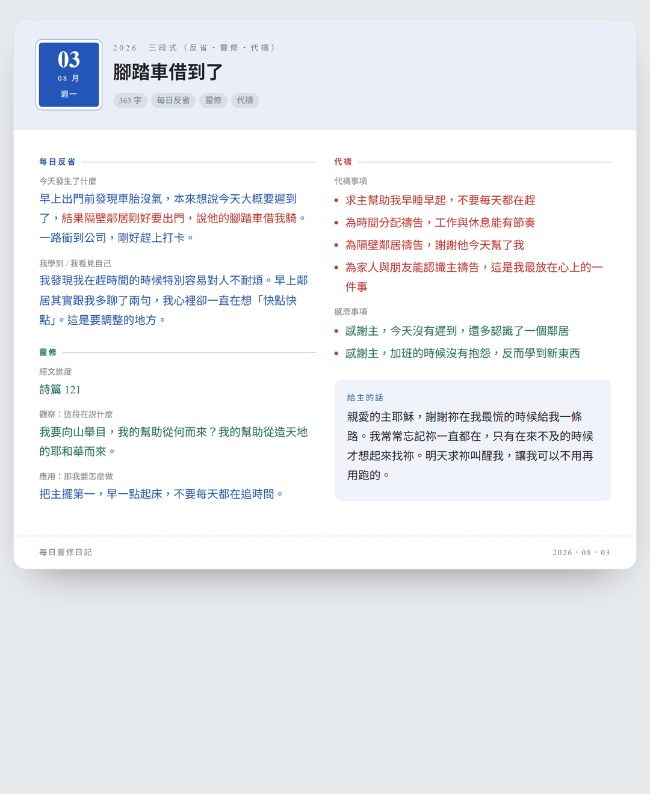
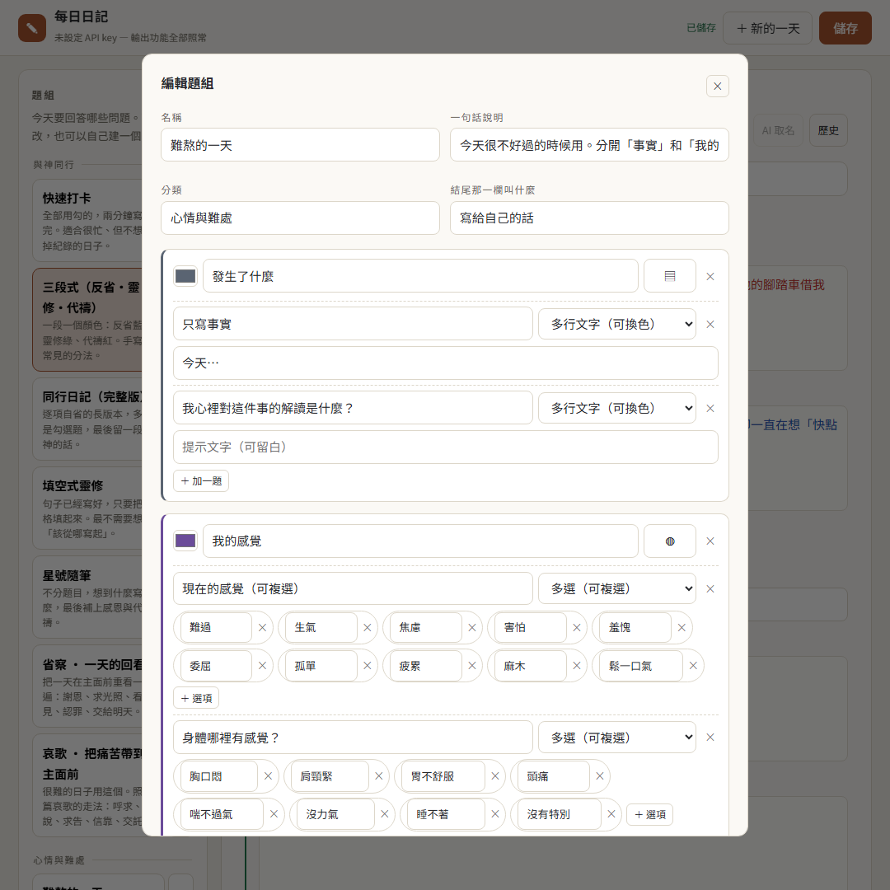
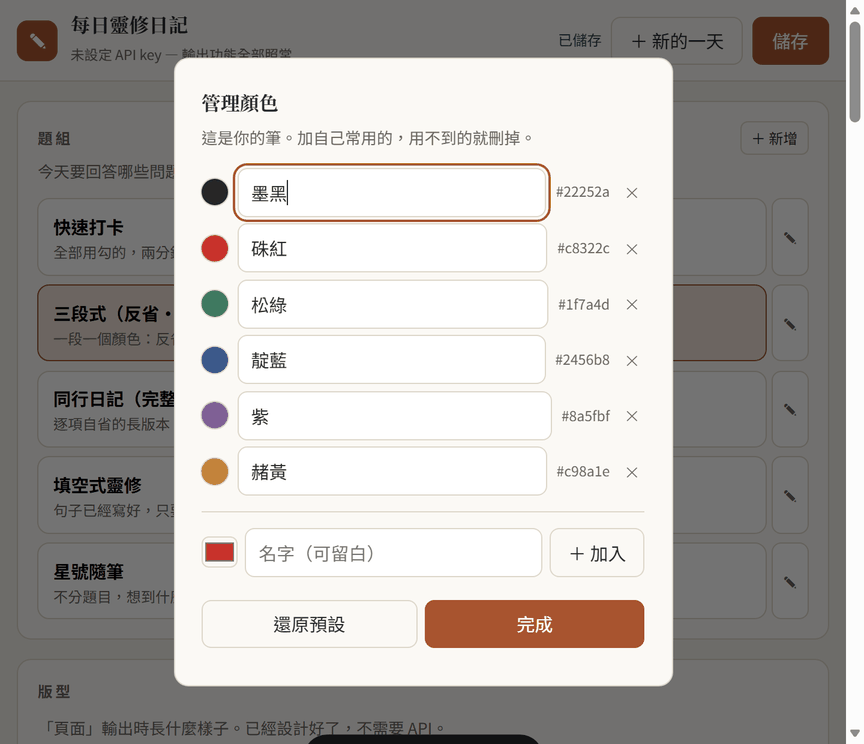
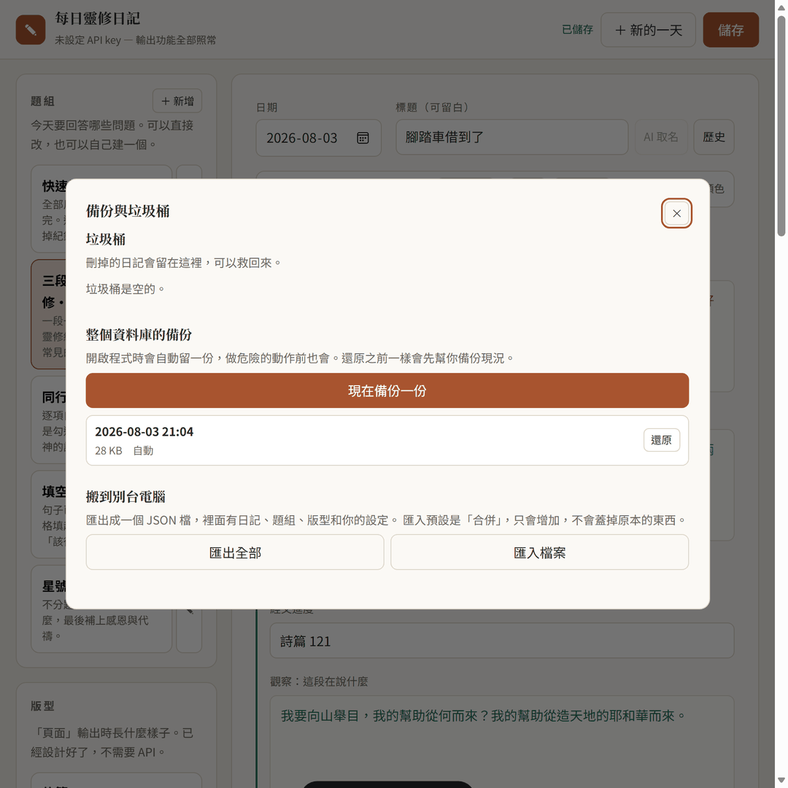
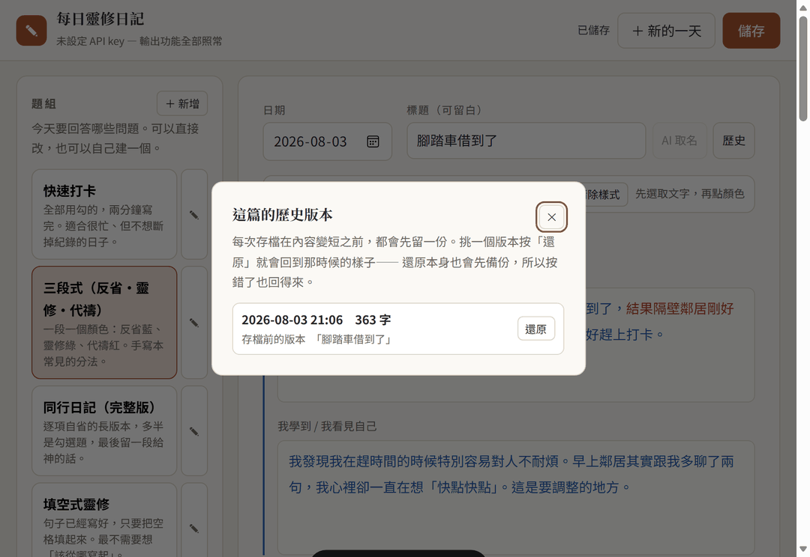

# 每日日記 · FastDailyJourneyWriter

一個寫日記的小工具。**挑一個題組、多半用勾的就寫完了**，
寫完可以直接輸出成一頁做好的 HTML，或一張像日記本內頁的圖片（手機 LINE 可以直接傳）。

輸出**不需要 API key**，也不需要連網。版型是事先設計好的完成品，寫完就是最後的樣子。



> 圖片裡的內容都是為了說明編出來的範例，不是誰真實的日記。

---

## 裡面有什麼

一開始是為了寫靈修日記做的，所以靈修那一套是完整的：讀經、省察、感恩、代禱，
還有難到說不出話的日子怎麼向神哀哭。後來加進來的題組不談信仰也用得上——
面對情緒、面對痛苦、工作與創業、想成為什麼樣的人。

有些題組把兩邊放在同一頁。「反思膠囊」問完「有哪一段經文用得上？」，
也會問「有沒有誰說過的一句話用得上？」，
輸出時兩種來源用不同顏色標開，看得出來哪句話是從哪裡來的。

題目都是往同一個方向問的：看清楚今天發生了什麼、對自己誠實、然後找出下一步。

**內建 19 個題組，分五類**：與神同行（靈修）、心情與難處、成為什麼樣的人、
工作與創業、簡單記一下。每一個在做什麼，看
**[docs/templates.md](docs/templates.md)**。全部可以改，也可以刪。

---

## 30 秒看懂

| | |
|---|---|
| **左邊** | 挑今天要回答哪些問題（題組）、挑輸出時長什麼樣子（版型） |
| **中間** | 寫。多半是勾選題，文字可以換色，像換筆一樣 |
| **右邊** | 輸出：一頁 HTML、一張圖片、或一段畫圖用的 prompt |

## 安裝與啟動

### 需要什麼

| | |
|---|---|
| **Python** | **3.11 或更新的版本**（在 3.11 上開發與測試）。下載：[**Python 3.11**](https://www.python.org/downloads/release/python-3119/) ｜ [其他版本](https://www.python.org/downloads/) |
| **其他** | 沒有了。不用 Node.js、不用資料庫、前端沒有 build 步驟。 |
| **硬碟** | 大約 90 MB（含相依套件） |

> **Windows 安裝 Python 時，記得勾選最下面的 `Add python.exe to PATH`。**
> 沒勾的話下面的指令會說「找不到 python」。
>
> 已經裝好了？用 `python --version` 確認一下是不是 3.11 以上。
> 如果電腦裡有好幾個版本，Windows 用 `py -3.11`、macOS／Linux 用 `python3.11` 指定。

### Windows

```powershell
git clone https://github.com/ChouYangEn0401/FastDailyJourneyWriter.git
cd FastDailyJourneyWriter

py -3.11 -m venv .venv
.venv\Scripts\activate
pip install -r requirements.txt

python run.py
```

之後每次要開，按兩下 **`run.bat`** 就好（不用先 activate）。

### macOS / Linux

```bash
git clone https://github.com/ChouYangEn0401/FastDailyJourneyWriter.git
cd FastDailyJourneyWriter

python3.11 -m venv .venv
source .venv/bin/activate
pip install -r requirements.txt

python run.py
```

之後每次要開：**`./run.sh`**（第一次要先 `chmod +x run.sh`）。

### 然後

程式會自己開一個本機伺服器，打開瀏覽器到 **<http://127.0.0.1:8888>** 就可以寫了。
第一次啟動時，內建的 19 個題組與 4 種版型會被複製到 `data/`。

要停止：在終端機按 `Ctrl + C`。

<details>
<summary>可以調整的環境變數</summary>

| 變數 | 預設 | 做什麼 |
|---|---|---|
| `JOURNAL_PORT` | `8888` | 換一個埠號（`8888` 被別的程式佔用時） |
| `JOURNAL_HOST` | `127.0.0.1` | 設成 `0.0.0.0` 可以讓同一個 Wi-Fi 下的手機連進來 |
| `JOURNAL_RELOAD` | `1` | 設成 `0` 關掉改檔自動重啟 |
| `JOURNAL_DATA_DIR` | `data` | 把日記存到別的地方（例如雲端同步資料夾） |

也可以用 `uvicorn backend.main:app --reload` 自己起。
</details>

---

## 輸出：同一篇日記，兩種形狀

這是最容易搞混的地方，所以先講清楚：**「頁面」和「卡片」是兩個不同的產物**，
不是同一個東西的兩種預覽。兩個都可以在右欄先預覽再決定要不要下載。

|  | 頁面 · HTML | 卡片 · 圖片 |
|---|---|---|
| 是什麼 | 一個 `.html` 檔 | 一張 SVG／PNG |
| 形狀 | 由**版型**決定，共 4 種 | 單欄，寬度可選 1080～2000 |
| 怎麼看 | 瀏覽器打開、可捲動、可列印成 PDF | 直接看圖、傳 LINE |
| 適合 | 自己回顧、印出來、寄給人 | 分享、截圖 |

### 卡片長這樣

文字是**真的坐在橫線上**的——排版節奏跟橫線間距用的是同一個格線。
紙有橫線／方格／點陣／空白四種。PNG 由瀏覽器轉檔，可選 ×1／×2／×3。



### 頁面有四種版型

<table>
<tr>
<td width="50%"><br>
<b>信箋 Letter</b><br>單欄、寬邊界、襯線標題。最耐看，長短文都合用。</td>
<td width="50%"><br>
<b>對帳 Ledger</b><br>左欄整理勾選答案，右欄放文字。勾選題多的題組用這個最清楚。</td>
</tr>
<tr>
<td><br>
<b>稿紙 Manuscript</b><br>整頁方格稿紙、字大、留白多。像把手寫本掃描下來。</td>
<td><br>
<b>明信片 Postcard</b><br>郵戳日期＋雙欄密排。短短的一天也有份量，適合截圖。</td>
</tr>
</table>

勾「加上可翻開的封面」，頁面會多一張要點一下才翻開的封面——把日記送給別人的那個想法。

### 第三種輸出：畫圖用的 prompt

從今天的內容生出中英各一段 prompt，忠實反映當天的事情與心情，可以直接貼給繪圖工具。

---

## 題組：內建 19 個，也可以自己改

側欄的題組按分類排好。點名字換題組，點右邊的鉛筆直接改，「＋ 新增」從空白開一個。



| 分類 | 有什麼 |
|---|---|
| **與神同行** | 快速打卡、三段式、同行日記（完整版）、填空式靈修、星號隨筆、省察（一天的回看）、哀歌（把痛苦帶到主面前） |
| **心情與難處** | 難熬的一天、情緒盤點、擔心的事分一分 |
| **成為什麼樣的人** | 我想成為什麼樣的人、高峰與低谷、反思膠囊、月回顧（這個月我變成了誰） |
| **工作與創業** | 創業日記（每天）、決策紀錄、週回顧 |
| **簡單記一下** | 三行日記、感恩清單 |

兩個核心的長版練習：

- **高峰與低谷** — 今天最開心和最難受的各一件事，各問到底。
  高處問「這裡面有多少不是我自己掙來的」「如果三個月後我因此驕傲，會從哪裡開始」；
  低處問「哪些是我能決定的、哪些不是」「信靠神在這件事上具體要做什麼」。
  上下各兩塊，一天可以練好幾次。
- **反思膠囊** — 一件事想到底：發生什麼、我的感受、學到什麼、
  **哪一段經文用得上**、**哪個有智慧的人說過的話用得上**、我現在怎麼看它。
  一天做一塊就夠，行有餘力做三塊。

每一個在做什麼、什麼時候用，看 **[docs/templates.md](docs/templates.md)**——
那份文件同時也是自己寫題組的說明書。

一個題組是幾個**段落**，每個段落有標題、顏色、和幾道**題目**。題目型態：

| 型態 | 編輯器長什麼樣 |
|---|---|
| 多行文字 | 大輸入框，可以換色 |
| 條列 | 可增可減的編號行 |
| 單行文字 | 一行 |
| 單選 | 一排藥丸，點一下選起來（例：有／沒有） |
| 多選 | 同上，可複選 |
| 程度 | 同上（例：滿意／還可以／缺乏） |
| 填空句 | 句子裡用 `{}` 當空格，UI 自動變成行內填空 |

題組也決定最後那個自由書寫欄叫什麼——靈修的題組是「給主的話」，
`難熬的一天` 是「寫給自己的話」，`決策紀錄` 是「補充」。這個標題會一路帶到輸出。

內建的可以照改、也可以刪。想拿回來：`POST /api/templates/{id}/restore`。

## 換色



編輯區上方有一排墨水色。**先選取文字，再點顏色**，跟換筆一樣。

按「管理顏色」可以加自己常用的顏色、刪掉用不到的，存在 `data/preferences.json`。

顏色會一路帶到 HTML 與卡片。段落預設顏色跟著題組走，也可以逐欄覆寫。

寫字的區域在深色模式下仍然是**淺色的紙**——因為你挑的墨水色是為淺色紙選的，
放在深色底上會看不見（「墨黑」跟深色輸入框幾乎同色）。介面其他部分照系統深淺色走。

<br clear="all">

---

## 存檔：不會弄丟東西

這是這個工具最花力氣的地方。如果要給別人用，最不能發生的事就是弄丟人家寫的東西。



**日常行為**

- **自動存**：停下來一秒多就存，右上角顯示「已儲存 HH:MM」。
- **不會亂建檔**：只點選題組／版型／顏色而沒寫字，不會產生日記。
- **同一天只有一篇**：重開程式會接著今天已經寫的那篇繼續。

**三層保護，每一層擋住上一層擋不住的狀況**

| 層 | 擋什麼 | 怎麼用 |
|---|---|---|
| **歷史版本** | 一次存檔存壞了 | 標題旁邊的「歷史」 |
| **垃圾桶** | 刪錯了 | 「備份與垃圾桶」→ 救回來 |
| **資料庫備份** | 程式改壞了、一次弄壞很多篇 | 「備份與垃圾桶」→ 還原 |
| **匯出 JSON** | 電腦壞了 | 「匯出全部」，存到雲端 |



細節：

- **內容變短之前一定先留一份**。單純往下寫不會一直產生版本，但只要一次存檔讓字數變少，
  舊的那份一定會先被保存起來。
- **刪除＝進垃圾桶**，不是消失。要真的清掉得再確認一次。
- **還原本身也會先備份**，所以按錯了也回得來。
- **開啟程式時自動備份一份**，做危險動作（還原、匯入）前也會。
- **換題組不會刪東西**：新題組沒有的題目，內容仍然留在那篇日記裡，只是暫時不顯示；
  編輯區上方會提示還留著幾段，換回原本的題組就會出現。
- **刪掉題組也不會刪日記**：用該題組寫的日記會退成純文字的「保留下來的內容」，
  仍然讀得到、也還能輸出。真的要刪還在用的題組，系統會先擋一次並說有幾篇在用。
- **兩個分頁同時開著也不會互相蓋掉**：比較舊的那個存檔時會被擋下來，讓你選要保留哪一邊。

**搬到別台電腦**：「匯出全部」會產生一個 JSON（日記＋題組＋版型＋設定）。
匯入預設是**合併**——只會增加，不會蓋掉原本的東西。

---

## 全部都是 `data/` 裡的檔案

程式裡沒有寫死任何題目或版型。第一次啟動時，內建的預設會被複製到 `data/`：

```
data/
  templates/*.json        題組
  layouts/<id>.html.j2    版型（Jinja2 模板）
  layouts/<id>.json       版型的名字、說明、標籤
  preferences.json        你的顏色與慣用設定
  journal.sqlite3         你的日記
  backups/                資料庫備份
  exports/                匯出的檔案
```

從此它們就是普通檔案：可以改、可以刪、可以複製一份改成自己的、可以傳給別人。
`.seeded.json` 記錄哪些預設安裝過了，所以刪掉的東西不會自己跑回來。

### 自己做一個題組

一個題組就是一個 JSON 檔。最短的可用範例、七種題目型態、每個鍵的意思，
還有內建那 19 個是照什麼原則寫的，都在 **[docs/templates.md](docs/templates.md)**。
做了好用的題組，歡迎開 PR 放進 `content/templates/`——
怎麼開 PR 看 **[CONTRIBUTING.md](CONTRIBUTING.md)**。

### 自己做一個版型

版型就是一個 Jinja2 模板，收到 `doc`（日記內容）、`t`（主題色）、`gift_cover`。
唯一一條硬規定：**文字一律用 `{{ line | runs }}` 輸出**，那是保留顏色的地方。
最快的做法是複製 `data/layouts/letter.html.j2` 改。

---

## 選配的 AI（不影響上面任何一項）

複製 `.env.example` 成 `.env`，填入 `ANTHROPIC_API_KEY` 才會啟用。兩個功能：

- **設計新版型** — Claude 設計一個新版型，**存成檔案**。之後你跟拿到檔案的人都可以直接
  用，不會再呼叫 API。一次設計，永久使用。
- **AI 取名** — 從內容取一個標題。

繪圖 prompt 有 key 會由 Claude 產生，沒有 key 則用內建規則，兩者都能用。

---

## 隱私

**這個 repo 不會、也不應該包含任何人的日記內容。**

- 日記、匯出檔、備份、你改過的題組與版型都在 `data/`，已被 `.gitignore` 擋掉。
- `.gitignore` 也擋掉所有 `*.png` / `*.jpg`，避免不小心把真實日記的截圖 commit 進來。
  唯一的例外是 `docs/images/`，那裡的圖片全部是編出來的範例（見該資料夾的 README）。
- `content/` 裡的預設題組只有題目結構、選項與段落顏色，沒有任何人的答案。

---

## 專案結構

分成五層，**由上而下越來越跟平台有關**。這樣分是為了讓最有價值的東西
（題目怎麼問、版面長什麼樣）不綁在 Python 上，也不綁在任何一個作業系統上。

```
content/                 ── 產品內容。純資料，沒有一行 Python
  templates/*.json         19 個內建題組
  layouts/<id>.html.j2     4 種版型（Jinja2）＋ 共用的封面、色彩 token
  layouts/<id>.json        版型的名字、說明、標籤

backend/                 ── 後端（Python）。四種平台共用同一份
  main.py                FastAPI；也可以直接 python backend/main.py
  models.py              題組 / 版型 / 日記 / 偏好的 schema
  storage.py             SQLite、歷史版本、垃圾桶、防覆蓋
  backup.py              資料庫快照、匯出匯入
  preferences.py         顏色與慣用設定
  seed_manager.py        第一次啟動把 content/ 複製到 data/
  template_registry.py   讀 data/templates/
  richtext.py            HTML 白名單清理、色彩 run 解析
  services.py            答案清理、載入、題組刪除後的救援視圖
  render/
    document.py          Entry + Template -> 兩個 renderer 共用的結構
    layout_registry.py   讀 data/layouts/
    artifact_html.py     -> 一頁 HTML
    card_svg.py          -> 筆記本卡片 SVG
    textlayout.py        中英混排斷行（含避頭尾）
    themes.py            五組紙張顏色
  ai/                    選配：版型設計、標題、繪圖 prompt
  routers/               FastAPI 路由

web/                     ── 前端（原生 JS，不需要 build）

platforms/               ── 只放「怎麼包成給人用的東西」，不放任何邏輯
  desktop/                 Windows 與 macOS 桌機版打包（共用同一份設定）
  ios/                     iPhone / iPad（規劃中）
  android/                 Android（規劃中）

data/                    ── 你的東西。gitignore，永遠不進 repo
```

**上面三層（`content/`、`backend/`、`web/`）不知道自己跑在哪個作業系統上。**
所有平台差異都關在 `platforms/` 裡面。這條界線是刻意的：
`backend/` 裡沒有任何一行 `sys.platform`，所以 Windows 和 macOS 跑的是同一份程式碼，
不需要、也不應該有兩份副本。

`content/` 又再放在 `backend/` 外面，因為那裡面沒有任何東西跟 Python 有關——
將來如果有別的客戶端（手機版、純瀏覽器版），可以直接沿用同一批檔案。
啟動時 `seed_manager.py` 把它複製一份到 `data/`，從此你改的是 `data/` 那份，
升級程式不會蓋掉你的修改。

各層的規矩寫在 **[platforms/README.md](platforms/README.md)**。

其他檔案：

```
run.bat / run.sh            開發時啟動（bat 給 Windows，sh 給 macOS/Linux）
build_desktop.bat / .sh     打包成 .exe / .app
run.py                      實際的進入點，上面四個都是叫它
requirements.txt            執行需要的套件
requirements-dev.txt        打包、測試才需要的套件
pyproject.toml              專案資訊、Python 版本下限、ruff 設定
LICENSE                     AGPL-3.0
CONTRIBUTING.md             想幫忙的話從這裡開始
IDEAS.md                    討論過但還沒做的想法
docs/templates.md           內建題組一覽 ＋ 自己寫題組的說明書
docs/roadmap.md             接下來的方向（含手機版怎麼走）
docs/images/                README 用的截圖（虛構內容）
```

## API

`GET /docs` 有完整的互動文件。

```
GET    /api/templates              題組清單
PUT    /api/templates/{id}         新增或修改題組
DELETE /api/templates/{id}         刪除（還在用會擋，需 ?force=true）
POST   /api/templates/{id}/restore 還原成內建版本
GET    /api/layouts                版型清單
PUT    /api/layouts/{id}           儲存修改過的版型
POST   /api/layouts/design         用 AI 設計新版型（需要 key）
GET    /api/entries                日記清單（含字數、是否空白）
GET    /api/entries/by-date/{d}    某天已經在寫的那篇
POST   /api/entries                新增
PATCH  /api/entries/{id}           更新（可帶 expected_updated_at 防覆蓋）
GET    /api/entries/{id}/revisions 這篇的歷史版本
GET    /api/entries/{id}/orphans   換題組會有哪些內容不顯示
POST   /api/entries/revisions/{id}/restore  還原到某個版本
GET    /api/backup/status          幾篇日記、幾份備份、垃圾桶幾筆
GET    /api/backup/trash           垃圾桶
POST   /api/backup/trash/{id}/restore       救回刪掉的日記
GET    /api/backup/list            備份清單
POST   /api/backup/create          手動備份
POST   /api/backup/restore/{name}  還原整個資料庫
GET    /api/backup/export          匯出全部（JSON）
POST   /api/backup/import          匯入（預設合併）
POST   /api/export/html            產生頁面
POST   /api/export/card            產生卡片 SVG
POST   /api/ai/image-prompt        繪圖 prompt（沒 key 有 fallback）
```

---

## 授權

**[GNU AGPL-3.0](LICENSE)**。白話說：

- **自己用，完全自由**，永遠免費。個人、教會、小組、公司內部都一樣，不用問、不用付錢。
- **可以改、可以散布**——但如果你把改過的版本給別人用，或架成網路服務讓別人連，
  你也要把你改過的原始碼一起公開。
- 想在**閉源**的產品裡使用，請來信談授權。

## 想幫忙？

最歡迎的貢獻是**新的題組**——一個 JSON 檔而已，
看 [docs/templates.md](docs/templates.md) 和 [CONTRIBUTING.md](CONTRIBUTING.md)。
